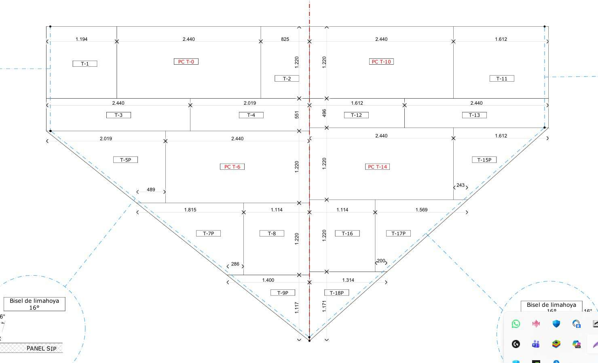

# Elicitación de requisitos
 
## Técnica 1: revisión documental
- Participante(s): Plano de Techo del Equipo de Arquitectos
- Fecha y modalidad: en linea
- Evidencia: 
- Hallazgos principales:
- 
  [1]Se confirma que cada plano se conforma de piezas y estos dan estructuras a diversas partes de la casa como en este caso es techo.
  
  [2]Se confirma que es clave contar con todas las piezas para el envio al cliente
   y que faltar una sola pieza en el envio puede ser un error critico tanto como para el cliente
  en tiempo y para la empresa en dinero y tiempo.
  
  [3]Se confirma que es complicado hacer una Procesamiento Automatizado que lea estos planos ya que es un contenido delicado del cual se tiene que asumir una gran responsabilidad y tampoco es tarea     sencilla por el presupuesto y el tiempo por lo que delegara la responsabilidad a los Trabajadores de la Empresa
  
 
## Técnica 2: entrevista
- Participante(s): Claudio Jefe de Operaciones de Paneles SIP
- Evidencia: 
- Hallazgos principales:
- 
 [1] Se confirma necesidad de mayor Trazabilidad y Registros de Proyectos y piezas-

 [2] Se confirma que la fabrica pasa por distintos procesos por lo tanto los paneles SIP tambien y que es necesario llevar mejor estos procesos mas alla de unas notas sueltas y la memoria de los   trabajadores sobretodo el diversos proyectos.
 
 [3] Se confirma necesidad de pruebas y confirmacion antes del envio y para finalizar proyectos.
 
 
## Acta de acuerdo

En el acuerdo se estableció con el Jefe de Operaciones que no se implementará Procesamiento Automatizado de lectores PDF y que será una página web para gestionar Proyectos y Paneles que incluirá una interfaz gráfica fácil de usar. Los datos se guardarán en una base de datos y la responsabilidad de la carga operativa recaerá en los trabajadores de la empresa al realizar el checklist, además de poder agregar fotos como evidencia visual para verificar si hay piezas faltantes antes de un momento importante como el envío de torres y proyectos.

### Clausula de responsabilidad sobre eliminación de datos ###

El sistema implementa mecanismos de protección activa para prevenir eliminaciones accidentales (solicitud de confirmación mediante 5 clics consecutivos y registro automático en una sección de auditoría del nombre del usuario junto con la marca de tiempo/timestamp). Sin embargo, la gestión, resguardo y decisión final de eliminar un proyecto o sus registros asociados es responsabilidad exclusiva del cliente/usuarios de la fábrica. El sistema garantiza la trazabilidad e identificación de quién realizó la acción, pero no se responsabiliza por la pérdida de información derivada de borrados confirmados ejecutados por el personal.
