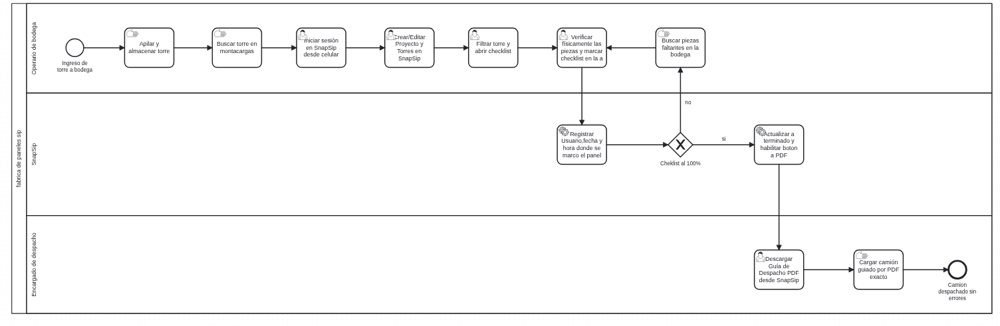

# Análisis de rediseño y propuesta TO-BE

## Mejoras identificadas por participante
| Participante | Objetivo | Problema | Mejora deseada |
|----------------|----------|----------|-----------------|
| Operario de bodega | Asegurar que todas las piezas estén listas para el despacho, sin tener que buscarlas a ciegas. | Búsqueda manual y exhaustiva torre por torre; pérdida de tiempo por desorden. | Uso de un checklist digital con estados visuales y buscador de piezas específico (SnapSip). |
| Encargado de despacho | Despachar los camiones de forma eficiente y sin errores en la carga de paneles. | Revisión visual de última hora durante la carga, lo que genera camiones incompletos y fletes extra. | Restringir el despacho obligando a generar una Guía en PDF validada al 100% por el sistema. |

## Iniciativas de rediseño
### Iniciativa 1
- Actividad(es) del AS-IS que afecta: Buscar pieza requerida con montacargas y Búsqueda exhaustiva torre por torre.
- Heurística aplicada: Automatización y control de accesos.
- Objetivo o mejora que resuelve: Eliminar búsquedas a ciegas mediante filtrado digital e identificación de usuarios.
- Efecto esperado (tiempo/costo/calidad/flexibilidad): Reducción del tiempo de búsqueda y aumento de la trazabilidad en terreno (calidad).

### Iniciativa 2
- Actividad(es) del AS-IS que afecta: Revisar visualmente las piezas mientras se carga el camión.
- Heurística aplicada: Integración de validación digital y reglas de negocio estrictas.
- Objetivo o mejora que resuelve: Evitar que se carguen camiones con torres incompletas mediante un bloqueo por software.
- Efecto esperado (tiempo/costo/calidad/flexibilidad): Eliminación de los sobrecostos por fletes adicionales (costo) y despachos eficientes.

## Diagrama TO-BE

Archivo fuente: [`./diagramas/to-be.bpmn`](./diagramas/to-be.bpmn)

Nota: distingan tareas de usuario, de servicio y manuales con el marcador correspondiente.

## Actividades que cambian del AS-IS al TO-BE
| Actividad en el AS-IS | Actividad en el TO-BE | Qué cambia |
|-------------------------|--------------------------|------------|
| (Acceso físico sin registro) | Iniciar sesión en SnapSip desde celular | Se agrega autenticación para registrar quién manipula la información de las torres. |
| (Gestión pasiva o nula) | Crear/Editar Proyecto y Torres en SnapSip | El operario asume el control directo de la estructura de proyectos y torres en la base de datos. |
| Buscar pieza requerida con montacargas | Filtrar torre y abrir checklist | La búsqueda física se reemplaza por una búsqueda digital filtrando por código específico (ej. "I1"). |
| Buscar frenéticamente las piezas faltantes en la bodega | Verificar físicamente las piezas y marcar checklist en la app | Se implementa una validación uno a uno en terreno mediante un checklist interactivo antes del despacho. |
| Revisar visualmente las piezas mientras se carga el camión | Descargar Guía de Despacho PDF desde SnapSip | El encargado ya no revisa a ciegas; descarga un PDF que el sistema solo habilita si el checklist está al 100%. |
